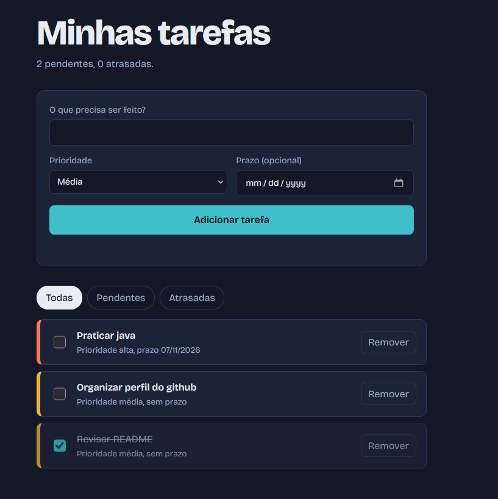

# 📝 Gerenciador de Tarefas


Gerenciador de tarefas com prioridades e prazos, feito em **Java 17** (linha de comando) e com uma **versão web** em HTML, CSS e JavaScript.

🔗 **Teste a versão web:** https://egroj-dev.github.io/gerenciador-tarefas/





## Funcionalidades

- Adicionar tarefas com título, prioridade (baixa, média ou alta) e prazo opcional
- Listar tarefas: pendentes primeiro, da maior para a menor prioridade
- Listar tarefas atrasadas
- Concluir e remover tarefas
- Dados salvos automaticamente (arquivo no Java, navegador na versão web)

## Tecnologias

| Parte | Tecnologias |
|---|---|
| Aplicação em linha de comando | Java 17, Maven |
| Testes | JUnit 5 |
| Integração contínua | GitHub Actions |
| Versão web | HTML, CSS e JavaScript (sem bibliotecas) |
| Hospedagem da versão web | GitHub Pages |

## Estrutura do projeto

```
├── .github/workflows/ci.yml        # roda build e testes a cada push
├── docs/                           # versão web (publicada no GitHub Pages)
│   ├── index.html
│   ├── style.css
│   └── script.js
├── src/main/java/com/exemplo/tarefas
│   ├── Main.java                   # ponto de entrada
│   ├── cli/Menu.java               # interação com o usuário
│   ├── model/                      # Tarefa e Prioridade
│   ├── repository/                 # interface + implementação em arquivo
│   └── service/TarefaService.java  # regras de negócio
├── src/test/java/...               # testes automatizados
└── pom.xml
```

O `TarefaService` depende da interface `TarefaRepository` e de um `Clock`. Por isso, as regras de negócio são testadas sem usar o disco e sem depender da data real.

## Como executar a versão Java

Requisitos: JDK 17 ou superior e Maven 3.8 ou superior.

```bash
git clone https://github.com/EGROJ-dev/gerenciador-tarefas.git
cd gerenciador-tarefas
mvn clean package
java -jar target/gerenciador-tarefas-1.0.0.jar
```

Para usar outro arquivo de dados:

```bash
java -jar target/gerenciador-tarefas-1.0.0.jar minhas-tarefas.tsv
```

Por padrão, as tarefas ficam em `~/.tarefas.tsv`.

## Testes

```bash
mvn test
```

São 7 testes que cobrem validações, ordenação, conclusão e detecção de tarefas atrasadas.

## Versão web

Abra `docs/index.html` no navegador, ou acesse o link no topo deste README. As tarefas ficam salvas no próprio navegador e não são compartilhadas com a versão Java.

## Próximos passos

- [ ] Editar tarefas existentes
- [ ] Filtrar por prioridade na versão Java
- [ ] Trocar o arquivo TSV por JSON ou SQLite
- [ ] Transformar em API REST com Spring Boot e conectar à versão web

## Autor

**Jorge Gabriel Cordeiro do Nascimento**
[LinkedIn](https://www.linkedin.com/in/jorge-gabriel-cordeiro-9b25702b) · [GitHub](https://github.com/EGROJ-dev)

## Licença

Distribuído sob a licença MIT. Veja o arquivo [LICENSE](LICENSE).
